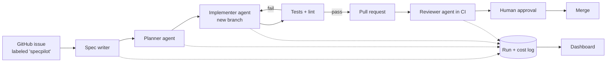

# SpecPilot

**An AI engineering assistant that turns GitHub issues into reviewed pull requests — with specs, guardrails, and cost tracking.**

SpecPilot explores how AI agents can speed up the software development lifecycle (SDLC) without losing quality or control. It reads an issue, writes a precise spec, implements the change with an agent, opens a pull request, reviews it in CI, and reports what every run cost.

> Status: 🚧 Work in progress — built in public over 10 weeks. See the [Roadmap](#roadmap).

---

## How it works



1. **Issue → Spec.** A short, informal issue becomes a structured spec: goal, requirements, acceptance criteria, affected files, and what's out of scope.
2. **Spec → Code.** An agent plans the work and implements it on a new branch, running tests after every change.
3. **Code → Pull request.** The agent opens a PR linked to the issue and the spec.
4. **Review.** A reviewer agent checks the PR against the spec's acceptance criteria and comments in CI.
5. **Human in the loop.** Nothing merges without human approval.
6. **Cost visibility.** Every model call is logged with tokens and cost, shown on the dashboard.

## Why spec-driven?

Issues leave decisions open, and agents fill gaps with guesses. Writing a spec first settles those decisions, gives the agent focused context, and creates clear acceptance criteria to verify the result against.

## Architecture

```
spec-pilot/
├── agent/          # Orchestration: spec writer, planner, implementer, reviewer (Claude Agent SDK)
├── mcp-servers/    # Reusable MCP servers (GitHub; Jira planned)
├── packages/       # Shared libraries, e.g. the GitHub REST client
├── skills/         # Claude Code skills: write-spec, revise-spec, implement-from-spec
├── agents/         # Claude Code subagents: spec-reviewer
├── .claude-plugin/ # Packages skills, subagents and the MCP server as a Claude Code plugin
├── dashboard/      # React + TypeScript dashboard for runs, specs, and costs
└── docs/           # Model comparisons, lessons learned, context engineering results
```

**Tech stack:** TypeScript, Node.js, Claude Agent SDK, Anthropic API, Model Context Protocol (MCP), GitHub Actions, SQLite → Postgres + pgvector, AWS (Lambda, Bedrock), Ollama, React.

## Roadmap

- [x] **Phase 0** — Repo setup, README, CLAUDE.md, demo target repo
- [x] **Phase 1** — Spec writer via LLM APIs + cost logging + model comparison
- [x] **Phase 2** — GitHub MCP server
- [x] **Phase 3** — Claude Code skills, hooks, subagents; spec-driven workflow
- [ ] **Phase 4** — Autonomous agent triggered by issue labels; AI review in CI; guardrails
- [ ] **Phase 5** — Context engineering with RAG (pgvector) + before/after results
- [ ] **Phase 6** — AWS deployment + routing simple tasks to a local open-weight model
- [ ] **Phase 7** — Dashboard, demo video, write-up

## Guardrails

- Max cost per run and max files changed per run
- Agent stops if tests keep failing
- Human approval required before merge
- API keys stored as secrets, never in code

## Results

- **[Model comparison](docs/model-comparison.md)** — Haiku, Sonnet and Opus writing specs for real issues: quality scores, cost, latency, and the effect of prompt caching.
- **[Cost report](docs/cost-report.md)** — average tokens, time and cost per model and task, generated from the usage log.

_Coming later:_ impact of retrieval on spec quality, and cost savings from model routing.

## Getting started

**Requirements:** Node.js 24+ (runs TypeScript directly; the only build step bundles the MCP server) and pnpm.

```bash
pnpm install
cp agent/.env.example agent/.env   # then add ANTHROPIC_API_KEY and GITHUB_TOKEN
```

**Write a spec** for an issue in the [demo target](#demo-target) repo:

```bash
pnpm --filter @spec-pilot/agent spec 3                             # Sonnet 5.5 (default)
pnpm --filter @spec-pilot/agent spec 3 claude-haiku-5-5 --cache    # another model, with prompt caching
```

The spec is saved to `agent/specs/issue-3.<model>.md`, and the call's tokens and cost are logged to `agent/usage.db`.

**Generate the cost report** from the usage log:

```bash
pnpm --filter @spec-pilot/agent cost   # writes docs/cost-report.md
```

**Or use only the GitHub MCP server** in Claude Code or any MCP client. It exposes `list_issues`, `get_issue`, `add_comment`, `create_branch` and `create_pull_request`:

```bash
claude mcp add github -e GITHUB_TOKEN=<your-token> -- node <path-to>/spec-pilot/mcp-servers/github/dist/server.mjs
```

For the full workflow in Claude Code, install the plugin instead (see [Claude Code plugin](#claude-code-plugin)).

**Run the tests and type-check:**

```bash
pnpm test
pnpm typecheck
```

## Claude Code plugin

SpecPilot is also a [Claude Code](https://code.claude.com) plugin. One install gives you the spec-driven skills (`write-spec`, `revise-spec`, `implement-from-spec`), the `spec-reviewer` subagent, and the GitHub MCP server, in every project you open.

### 1. Create a GitHub token

Create a [fine-grained personal access token](https://github.com/settings/personal-access-tokens), limited to the repositories SpecPilot should work on and with an expiration date:

| Permission    | Access               | Used for                         |
| ------------- | -------------------- | -------------------------------- |
| Metadata      | Read-only (required) | Repository info                  |
| Issues        | Read and write       | Reading issues, posting comments |
| Contents      | Read and write       | Creating branches                |
| Pull requests | Read and write       | Opening pull requests            |

### 2. Set `GITHUB_TOKEN` in your environment

The plugin's MCP server reads the token from the environment; there is no `.env` file in an installed plugin.

**Windows** (Command Prompt or PowerShell):

```cmd
setx GITHUB_TOKEN "github_pat_..."
```

**macOS / Linux**: add to your shell profile (e.g. `~/.zshrc` or `~/.bashrc`):

```bash
export GITHUB_TOKEN="github_pat_..."
```

Then **open a new terminal**. Terminals and apps (like VS Code) that were already open don't see the new variable until they restart.

### 3. Install

From a terminal:

```bash
claude plugin marketplace add peter-85/spec-pilot
claude plugin install specpilot@specpilot
```

Or inside an interactive Claude Code session (`claude`):

```
/plugin marketplace add peter-85/spec-pilot
/plugin install specpilot@specpilot
```

When asked for a scope, choose **user scope** to use SpecPilot in every project. Project scope records it in the repo's `.claude/settings.json`, so everyone who clones that repo gets it, which is useful when a team adopts SpecPilot.

> **VS Code extension:** `/plugin` isn't available in the extension. Run the commands above in VS Code's integrated terminal, then restart VS Code completely. The extension shares the same settings, so it loads the plugin, and the restart lets it see `GITHUB_TOKEN`.

### 4. Check it works

- `/mcp` shows `plugin:specpilot:github-specpilot` as **Connected**.
- Typing `/specpilot:` lists the three skills.

If the server isn't connected, `GITHUB_TOKEN` is usually missing from the environment Claude Code was started in: check with `echo %GITHUB_TOKEN%` (cmd), `echo $env:GITHUB_TOKEN` (PowerShell) or `echo $GITHUB_TOKEN` (bash), and restart from a new terminal.

### Usage

Run these in the project you want to work on, not in the SpecPilot repo. Plugin commands carry the `specpilot:` prefix, so they never clash with other skills.

| Step      | Command                                                                     | What it does                                                                                                                                                     |
| --------- | --------------------------------------------------------------------------- | ---------------------------------------------------------------------------------------------------------------------------------------------------------------- |
| 1. Spec   | `/specpilot:write-spec 12`                                                  | Reads issue #12 and the code it touches, then writes `specs/issue-12.md`. Every open question has a proposed answer and a blocking flag.                         |
| 2. Decide | `/specpilot:revise-spec 12 Q1: full timestamp. Q2: accept proposed.`        | Applies your answers, records them under Decisions, and sets `Status: approved` when no blocking questions remain.                                               |
| 3. Build  | `/specpilot:implement-from-spec 12`                                         | Refuses draft specs. Shows a plan and waits for approval, then implements on branch `specpilot/issue-12`, adds tests, runs the suite, and commits. Never pushes. |
| 4. Review | _"Use the spec-reviewer subagent to review this branch against issue #12."_ | A read-only reviewer with a fresh context checks the branch against the spec's acceptance criteria, decisions, and scope.                                        |
| 5. PR     | _"Open a pull request for this branch with the github-specpilot server."_   | After you push the branch, opens the PR with `Closes #12`.                                                                                                       |

Asking in plain words ("write a spec for issue #12") also works; only `implement-from-spec` must be started explicitly.

### Plugin layout

```
spec-pilot/
├── .claude-plugin/
│   ├── plugin.json          # name and version
│   └── marketplace.json     # makes this repo installable as a plugin source
├── .mcp.json                # starts mcp-servers/github/dist/server.mjs with GITHUB_TOKEN
├── skills/                  # write-spec, revise-spec, implement-from-spec
└── agents/                  # spec-reviewer
```

`dist/server.mjs` is a single-file bundle (esbuild), committed because an installed plugin doesn't include `node_modules`.

### Releasing a change

1. If the MCP server or `packages/github` changed, rebuild: `pnpm --filter @spec-pilot/github-mcp-server build`, and commit `dist/server.mjs`.
2. Increase `version` in `.claude-plugin/plugin.json`.
3. Commit and push.
4. In Claude Code, update the plugin from `/plugin`, then restart.

## Demo target

SpecPilot is developed against [`to-do-app-node`](https://github.com/peter-85/to-do-app-node), a real to-do REST API built with Express 5, Prisma 8, PostgreSQL, and JWT authentication. Its GitHub issues are the work SpecPilot picks up.

## Author

**Petar Georgiev** — front-end engineer (9 years) exploring AI-native software engineering.
