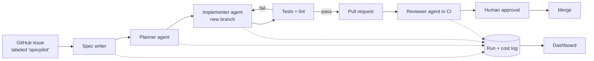

# SpecPilot

**An AI engineering assistant that turns GitHub issues into reviewed pull requests — with specs, guardrails, and cost tracking.**

SpecPilot explores how AI agents can speed up the software development lifecycle (SDLC) without losing quality or control. It reads an issue, writes a precise spec, implements the change with an agent, opens a pull request, reviews it in CI, and reports what every run cost.

> Status: 🚧 Work in progress — built in public over 10 weeks. See the [Roadmap](#roadmap).

---

## How it works



1. **Issue → Spec.** A short, informal issue becomes a structured spec: goal, requirements, acceptance criteria, affected files, and what's out of scope.
2. **Spec → Code.** An agent plans the work and implements it on a new branch, running tests after every change.
3. **Code → Pull request.** The agent opens a PR linked to the issue and the spec.
4. **Review.** A reviewer agent checks the PR against the spec's acceptance criteria and comments in CI.
5. **Human in the loop.** Nothing merges without human approval.
6. **Cost visibility.** Every model call is logged with tokens and cost, shown on the dashboard.

## Why spec-driven?

Issues leave decisions open, and agents fill gaps with guesses. Writing a spec first settles those decisions, gives the agent focused context, and creates clear acceptance criteria to verify the result against.

## Architecture

```
spec-pilot/
├── agent/          # Orchestration: spec writer, planner, implementer, reviewer (Claude Agent SDK)
├── mcp-servers/    # Reusable MCP servers (GitHub; Jira planned)
├── skills/         # Claude Code skills: write-spec, implement-from-spec, review-against-spec
├── dashboard/      # React + TypeScript dashboard for runs, specs, and costs
└── docs/           # Model comparisons, lessons learned, context engineering results
```

**Tech stack:** TypeScript, Node.js, Claude Agent SDK, Anthropic API, Model Context Protocol (MCP), GitHub Actions, SQLite → Postgres + pgvector, AWS (Lambda, Bedrock), Ollama, React.

## Roadmap

- [ ] **Phase 0** — Repo setup, README, CLAUDE.md, demo target repo
- [ ] **Phase 1** — Spec writer via LLM APIs + cost logging + model comparison
- [ ] **Phase 2** — GitHub MCP server
- [ ] **Phase 3** — Claude Code skills, hooks, subagents; spec-driven workflow
- [ ] **Phase 4** — Autonomous agent triggered by issue labels; AI review in CI; guardrails
- [ ] **Phase 5** — Context engineering with RAG (pgvector) + before/after results
- [ ] **Phase 6** — AWS deployment + routing simple tasks to a local open-weight model
- [ ] **Phase 7** — Dashboard, demo video, write-up

## Guardrails

- Max cost per run and max files changed per run
- Agent stops if tests keep failing
- Human approval required before merge
- API keys stored as secrets, never in code

## Results

_Coming soon:_ model quality vs cost, impact of retrieval on spec quality, and cost savings from model routing.

## Getting started

_Setup instructions will be added once Phase 1 is complete._

## Demo target

SpecPilot is developed against [`to-do-app-node`](https://github.com/peter-85/to-do-app-node), a real to-do REST API built with Express 5, Prisma 8, PostgreSQL, and JWT authentication. Its GitHub issues are the work SpecPilot picks up.

## Author

**Petar Georgiev** — front-end engineer (9 years) exploring AI-native software engineering.
